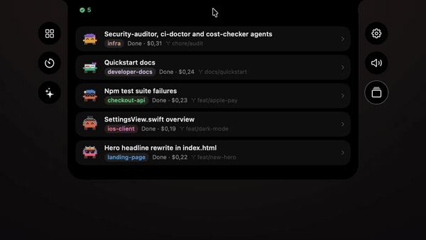

<h1 align="center">Claude sessions in your notch</h1>

<p align="center">
  Every Claude Code session on your Mac, in the Dynamic Island.<br>
  Allow, answer and reply without switching to the terminal.
</p>

<p align="center">
  <a href="#what-it-does">What it does</a> ·
  <a href="#set-it-up">Set it up</a> ·
  <a href="#how-it-works">How it works</a> ·
  <a href="#private-by-default">Privacy</a> ·
  <a href="#on-windows">Windows</a> ·
  <a href="#about-this-fork">About this fork</a>
</p>

<p align="center">
  
</p>


This is an unofficial fork of [Vorssaint](https://github.com/vorssaint/vorssaint-utils) that adds a Sessions section to its Dynamic Island. It is not affiliated with or endorsed by the Vorssaint maintainer. Everything in the video is the real app driving real Claude Code sessions, recorded on a MacBook.

## What it does

- **Every session at a glance.** Running sessions are listed beside the camera with their name, project, git branch and state: working, running a tool, waiting for permission, waiting for you, done or idle. Each project gets its own color, and a session that sat idle for a while fades out.
- **Allow from the island.** When Claude asks to run something, the island opens on its own with the whole command in view. Allow, Deny or Always, by click or with ⌘Y and ⌘N.
- **Answer Claude's questions.** Questions Claude asks with options show up as a card. Pick one, pick several, or write your own answer.
- **Reply without switching apps.** Type a reply in the island and it reaches the session in Terminal or Antigravity as if typed there. ⌘↩ sends, and ⌘V or a drop adds images.
- **Watch it work.** Enlarge a session's page to read the whole conversation as it grows, with recent tools, tasks, cost and the model beside it, or fold the details away.
- **Subagents too.** Agents a session starts get rows of their own, including the ones sent to the background, colored like their agent definitions.
- **A Clawd for every session.** Each session and subagent gets a pixel Clawd in a random costume. Open the wardrobe to change its shell, hat, eyewear and extras, or let Surprise me pick.

## Set it up

You need a Mac with Apple Silicon, macOS 14 or newer, the Xcode Command Line Tools and [Claude Code](https://docs.anthropic.com/en/docs/claude-code).

1. Build and install it:

   ```sh
   git clone https://github.com/MF-DEEV/vorssaint-utils.git
   cd vorssaint-utils
   ./build.sh --dev --install
   ```

   This installs a separate Developer build next to any official Vorssaint. Run only one of them at a time, or you get two islands.

2. In Settings, install the AI Agents feature from the Features hub, then turn on the Sessions section in the Dynamic Island settings.
3. In the Sessions settings, press **Install Hooks**. Hooks let the island show which tool runs and answer permission prompts and questions. They are added to `~/.claude/settings.json` next to your own, after a backup, and **Remove Hooks** takes them out again.
4. If you work in Antigravity, press **Install Extension** so replies can reach its terminals. For Terminal, macOS asks for Automation access the first time you send a reply.
5. Start `claude` in Terminal or Antigravity. The session shows up in the island.

## How it works

The island reads the small records Claude Code keeps for each running session in `~/.claude/sessions`, then follows that session's transcript, subagents and tasks as they grow. Permission prompts and questions arrive through Claude Code's own hooks, which talk to the app over a local socket. Claude Code shows the same prompt in the terminal at the same time, and whichever answer comes first wins. With the app closed, Claude Code simply asks in the terminal as usual.

Replies are typed into the session's own Terminal tab, found by its terminal device, or into its Antigravity terminal through the extension.

## Private by default

Nothing leaves your Mac. Prompts, replies, titles and commands stay unread until you turn on **Show previews**, which is off by default, and even then they are kept in memory only and cleared when you turn it off. The [privacy notes](docs/PRIVACY.md) list everything the Sessions page reads and writes, and the [permissions guide](docs/PERMISSIONS.md) covers the Automation access replies use.

## On Windows

The Dynamic Island also runs on Windows 11, with the same Sessions list for Claude Code and Codex, Now Playing and notifications. It is a beta with its own installer: download it from the [Windows releases](https://github.com/MF-DEEV/vorssaint-utils/releases?q=windows&expanded=true) (x64 for most PCs, arm64 for Snapdragon), and read [windows/README.md](windows/README.md) for what it does and how to build it.

## About this fork

The rest of the app is Vorssaint as it is upstream: volume mixer, system monitor, app switcher, window snapping, clipboard history, the Dynamic Island and much more. Its [README](https://github.com/vorssaint/vorssaint-utils#readme) describes all of it, and official builds come only from the [Vorssaint releases](https://github.com/vorssaint/vorssaint-utils/releases).

On the Mac this fork ships no builds of its own; you build it from source as above. The Windows island has installers in this repository's releases. The Vorssaint name, icon and look belong to its maintainer, as [TRADEMARKS.md](TRADEMARKS.md) explains.

- [Privacy](docs/PRIVACY.md), what does and does not leave your Mac
- [Permissions](docs/PERMISSIONS.md), every macOS permission in plain words
- [Troubleshooting](docs/TROUBLESHOOTING.md), the common fixes
- [Contributing](CONTRIBUTING.md), build, layout and conventions
- [Claude Code session notes](docs/claude-sessions-spike.md), what Claude Code exposes and how the island uses it

## License

[GPL 3.0 or later](LICENSE). Vorssaint is copyright 2026 Vorssaint; the changes in this fork are copyright 2026 MF DEV under the same license.

<p align="center">
  <sub>Fork by <a href="https://github.com/MF-DEEV">MF DEV</a> · Based on <a href="https://github.com/vorssaint/vorssaint-utils">Vorssaint</a></sub>
</p>
