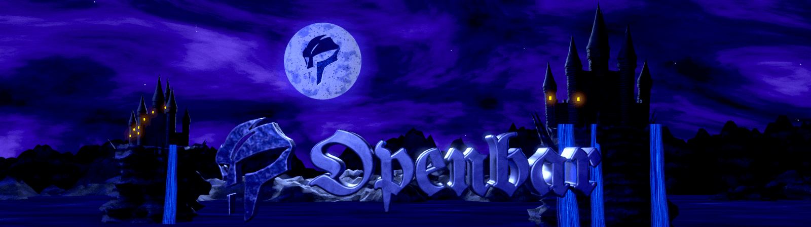
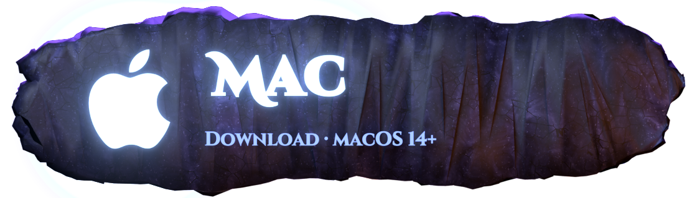
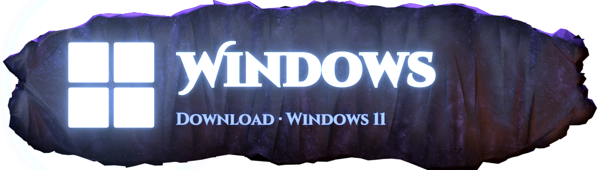
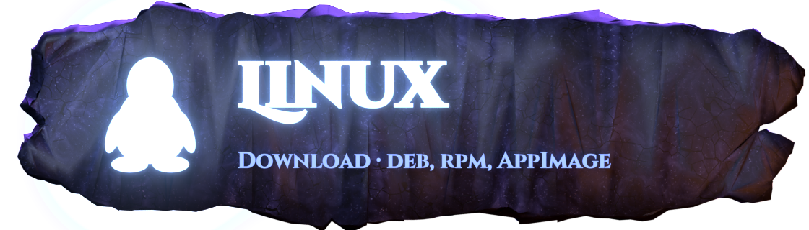
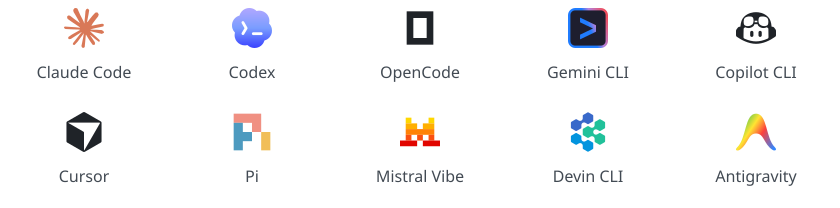
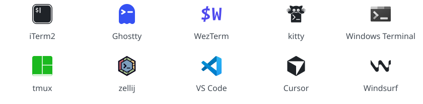
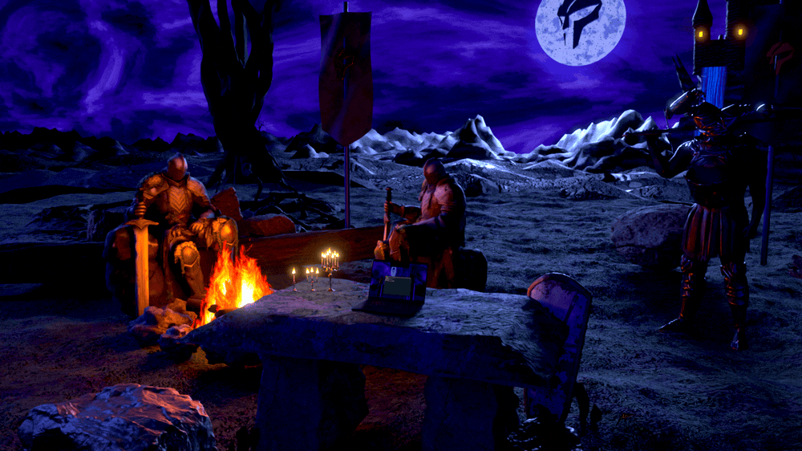

<p align="center">
  
</p>

<h3 align="center">Your coding agents, in the notch.</h3>

<p align="center">
  Openbar lists every Claude Code and Codex session beside your Mac's camera.<br>
  When one needs you, you allow it, answer it or reply from there.
</p>

<p align="center">
  <a href="#install"></a>
  <a href="windows/README.md"></a>
  <a href="windows/docs/linux.md"></a>
  <a href="LICENSE"></a>
</p>

<p align="center">
  <a href="https://github.com/MF-DEEV/Openbar/releases?q=Mac&expanded=true"></a>
  <a href="https://github.com/MF-DEEV/Openbar/releases?q=windows&expanded=true"></a>
  <a href="https://github.com/MF-DEEV/Openbar/releases?q=%22for+Linux%22&expanded=true"></a>
</p>

<p align="center">
  <a href="docs/README.md">Features and guides</a>
  &nbsp;&nbsp;&nbsp;
  <a href="https://github.com/MF-DEEV/Openbar/discussions">Discussions</a>
</p>

<p align="center">
  <picture>
    <source media="(prefers-color-scheme: dark)" srcset="docs/assets/readme/agents/agents-dark.svg">
    
  </picture>
</p>

<p align="center">
  <a href="docs/terminal-hosts.md">
    <picture>
      <source media="(prefers-color-scheme: dark)" srcset="docs/assets/readme/terminals/terminals-dark.svg">
      
    </picture>
  </a>
</p>

<p align="center">
  
</p>

<p align="center"><sub>Models: knights by mp4967qwp, JakeHoughton and best3deu, trees by Yag1z and evolveduk, laptop "2021 Macbook Pro 14" (M1 Pro / M1 Max)" by akshatmittal, all on Sketchfab under <a href="https://creativecommons.org/licenses/by/4.0/">CC BY 4.0</a>; scans from Poly Haven (CC0). <a href="docs/assets/brand/source/fantasy/MODELS.md">Sources</a>.</sub></p>

## What Openbar does

- Permission requests, questions and plans open in the island with the full command or diff.
- A reply you type or speak lands in the session's own terminal or editor.
- Claude Code, Codex, OpenCode, Gemini CLI, Copilot CLI, Cursor, Pi, Mistral Vibe, Devin CLI, Google Antigravity, Grok CLI, ZCode and Hermes share one list.
- Each session you start from the island gets its own git worktree.
- Nothing leaves your machine ([privacy](docs/PRIVACY.md)).
- A menu bar toolkit comes with it: a volume mixer, a system monitor, clipboard history and more.

## Install

**Mac** (Apple Silicon, macOS 14 or later), with Homebrew:

```sh
brew install --cask mf-deev/openbar/openbar
```

Or get the DMG from the [latest Mac release](https://github.com/MF-DEEV/Openbar/releases?q=Mac&expanded=true) and drag Openbar to Applications. It isn't notarized yet, so the first time choose **Open Anyway** in System Settings › Privacy & Security.

**Windows 11**, with winget:

```powershell
winget install MFDEV.Openbar
```

Or run the installer from the [latest Windows release](https://github.com/MF-DEEV/Openbar/releases?q=windows&expanded=true).

On the Mac and on Windows, Openbar then updates itself: it checks once a day and asks before installing. `brew upgrade` and `winget upgrade` work too.

**Linux** (X11, beta): get the `.deb`, `.rpm` or AppImage from the [latest Linux release](https://github.com/MF-DEEV/Openbar/releases?q=%22for+Linux%22&expanded=true), for x86_64 or Arm64. On Wayland the island works on compositors with layer-shell and on GNOME through XWayland, with some features still X11 only; see the [Linux notes](windows/docs/linux.md).

On the Mac, turn sessions on in Openbar's Settings: install **AI Agents** in the Features hub, turn on **Sessions** under Dynamic Island and press **Install Hooks** for Claude Code. Then start `claude` or `codex`.

## Docs

[Features and guides](docs/README.md) · [Privacy](docs/PRIVACY.md) · [Permissions](docs/PERMISSIONS.md) · [Troubleshooting](docs/TROUBLESHOOTING.md) · [Windows](windows/README.md) · [Contributing](CONTRIBUTING.md) · [Security](SECURITY.md) · [Code of conduct](CODE_OF_CONDUCT.md)

## License

[GPL 3.0 or later](LICENSE). Openbar is built on [Vorssaint](https://github.com/vorssaint/vorssaint-utils), copyright 2026 Vorssaint; the changes in this repository are copyright 2026 MF DEV, Adrian (@atekuu) and the Openbar contributors, under the same license. Openbar is not affiliated with Vorssaint; see [TRADEMARKS.md](TRADEMARKS.md).

## Contributors

<div align="center">
  <table>
    <tr>
      <td align="center" width="150"><a href="https://github.com/MF-DEEV"><br><b>MF DEV</b></a></td>
      <td align="center" width="150"><a href="https://github.com/atekuu"><br><b>Adrian</b></a></td>
      <td align="center" width="150"><a href="https://github.com/Dotims"><br><b>Dotims</b></a></td>
    </tr>
  </table>
</div>
