<p align="center">
  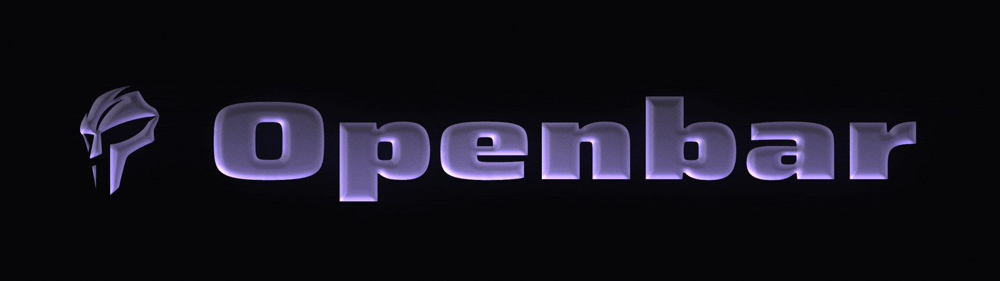
</p>

<h3 align="center">Your coding agents, in the notch.</h3>

<p align="center">
  Allow, answer and reply to Claude Code, Codex and four more agents<br>
  from your Mac's Dynamic Island. A full menu bar toolkit comes with it.
</p>

<p align="center">
  <a href="#get-started"></a>
  <a href="windows/README.md"></a>
  <a href="https://github.com/MF-DEEV/Openbar/releases?q=windows&expanded=true"></a>
  <a href="LICENSE"></a>
</p>

<p align="center">
  <a href="#get-started"><b>Build for Mac</b></a>
  &nbsp;&nbsp;&nbsp;
  <a href="https://github.com/MF-DEEV/Openbar/releases?q=windows&expanded=true"><b>Download for Windows</b></a>
  &nbsp;&nbsp;&nbsp;
  <a href="#documentation">Docs</a>
  &nbsp;&nbsp;&nbsp;
  <a href="https://github.com/MF-DEEV/Openbar/discussions">Discussions</a>
</p>

<br>

<p align="center">
  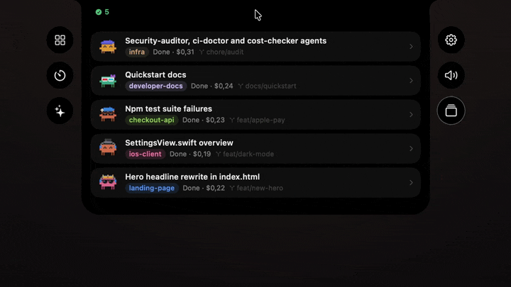
</p>

## Sessions

Every agent session on your machine, beside the camera. When one needs you, the island opens with the request in full.

<table>
  <tr>
    <td width="50%">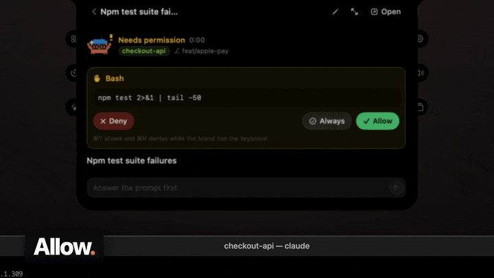</td>
    <td width="50%">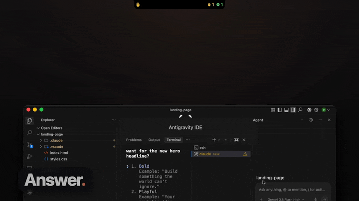</td>
  </tr>
  <tr>
    <td><b>Allow</b><br>Allow, Deny or Always, with the whole command or the file diff in view. <kbd>⌘Y</kbd> <kbd>⌘N</kbd> <kbd>⌘T</kbd> work from any app.</td>
    <td><b>Answer</b><br>Pick one option, several, or write your own.</td>
  </tr>
  <tr>
    <td>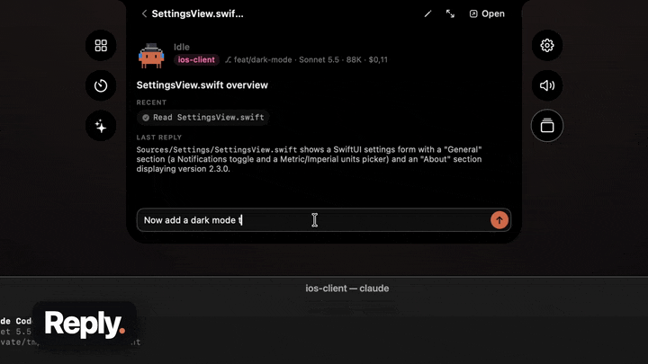</td>
    <td>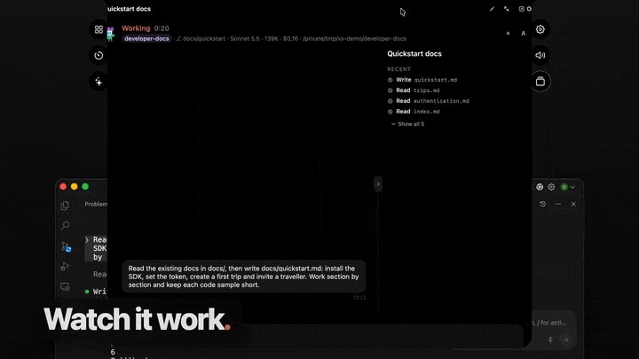</td>
  </tr>
  <tr>
    <td><b>Reply</b><br>Type in the island and it lands in the session's own terminal or editor. Images too.</td>
    <td><b>Watch</b><br>Enlarge a session to read the conversation live, with tools, tasks, cost and model.</td>
  </tr>
  <tr>
    <td>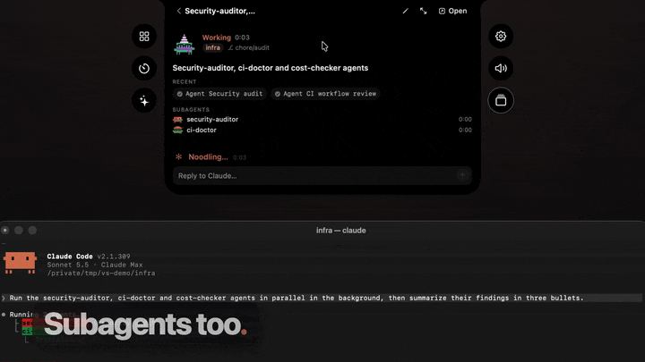</td>
    <td>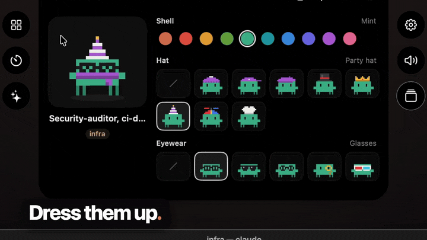</td>
  </tr>
  <tr>
    <td><b>Subagents</b><br>Agents a session starts get rows of their own, background ones included.</td>
    <td><b>A Clawd each</b><br>Every session gets a pixel buddy in a random costume. Dress it up.</td>
  </tr>
</table>

| Agent | In the list | Approve in the island | Reply from the island |
|---|:-:|:-:|:-:|
| Claude Code | ✓ | ✓ | ✓ |
| Codex | ✓ | ✓ | ✓ |
| OpenCode | ✓ | ✓ | ✓ |
| Gemini CLI | ✓ | in Gemini CLI | ✓ |
| Copilot CLI | ✓ | in Copilot CLI | ✓ |
| Cursor | ✓ | in Cursor | `cursor-agent` only |

Background sessions (`claude --bg`), plan limits and **New session** are there too. See [what each agent allows](docs/more-session-agents.md) and [which terminals replies reach](docs/terminal-hosts.md).

## The rest of your Mac

Openbar grew out of a full menu bar toolkit, and all of it is still here. Install only the features you use.

<table>
  <tr>
    <td width="50%"></td>
    <td width="50%"></td>
  </tr>
  <tr>
    <td><b>App switcher</b><br>Windows, not just apps, with live previews.</td>
    <td><b>Shelf</b><br>Park files on the way from one app to another.</td>
  </tr>
  <tr>
    <td></td>
    <td></td>
  </tr>
  <tr>
    <td><b>Cut and paste</b><br><kbd>⌘X</kbd> and <kbd>⌘V</kbd> move files in Finder.</td>
    <td><b>Quit on close</b><br>Closing the last window quits the app.</td>
  </tr>
</table>

A volume mixer, a system monitor, clipboard history, window layouts, keep awake, Now Playing, a timer, a calendar, downloads and more are each one switch away in the Features hub.

## On Windows 11

The same island, built with Tauri, hangs from the top of a Windows 11 screen. It's a beta with its own installer for x64 and arm64.

<p align="center">
  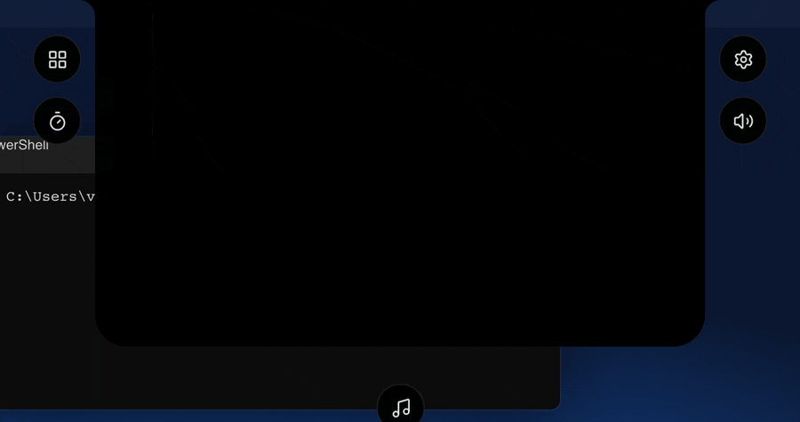
</p>

<table>
  <tr>
    <td width="50%">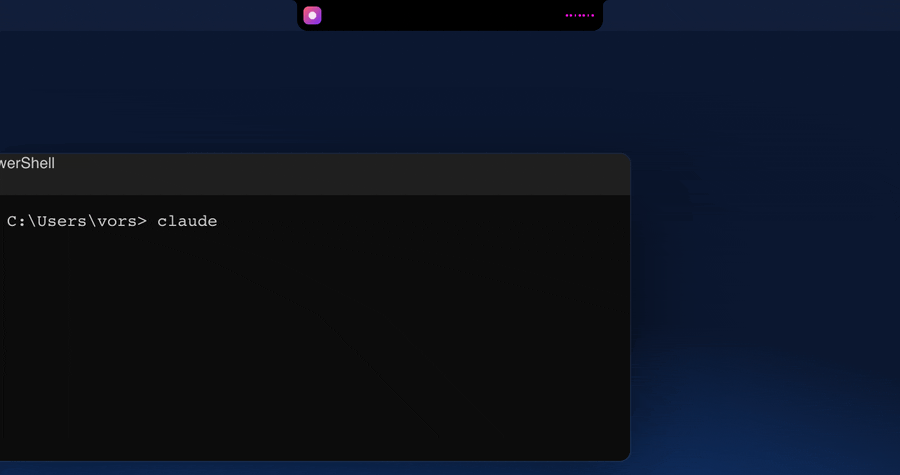</td>
    <td width="50%">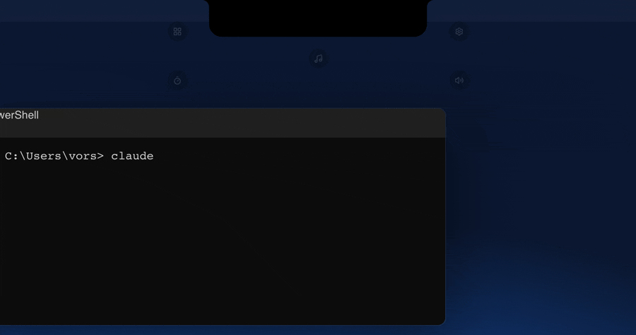</td>
  </tr>
  <tr>
    <td><b>Now Playing</b><br>Spotify, a browser or Media Player, with synced lyrics and what's up next.</td>
    <td><b>Controls and mixer</b><br>Volume, outputs and a level for every app playing sound.</td>
  </tr>
  <tr>
    <td>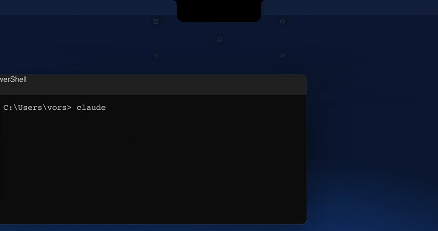</td>
    <td>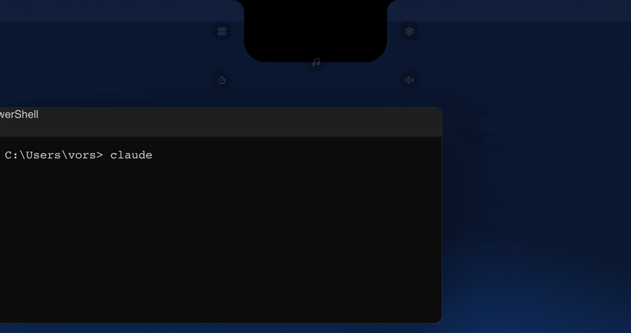</td>
  </tr>
  <tr>
    <td><b>System</b><br>Processor, memory, battery, network and disk, live, with history a click away.</td>
    <td><b>Clipboard and Files</b><br>A searchable clipboard history and a shelf for files on the move.</td>
  </tr>
</table>

<p align="center"><sub>Recorded from the Windows island's own interface with sample data.</sub></p>

[Download the installer](https://github.com/MF-DEEV/Openbar/releases?q=windows&expanded=true) or [read the Windows notes](windows/README.md) for timers, calendar, downloads, screen capture, Watch and the rest.

## Get started

**Mac**: Apple Silicon, macOS 14 or later and the Xcode Command Line Tools.

```sh
git clone https://github.com/MF-DEEV/Openbar.git
cd Openbar
./build.sh --dev --install
```

Then, in Settings:

1. Install **AI Agents** from the Features hub and turn on **Sessions** under Dynamic Island.
2. Press **Install Hooks** for Claude Code. Your `~/.claude/settings.json` is backed up first, and **Remove Hooks** takes them out. Codex needs nothing.
3. Start `claude` or `codex`. The session appears in the island.

> [!NOTE]
> The build is still named **Vorssaint (Developer)**, after the project Openbar is built on. Run only one of them at a time, or you get two islands.

**Windows**: run the installer from the [latest Windows release](https://github.com/MF-DEEV/Openbar/releases?q=windows&expanded=true). It installs for your account only.

## Private by default

> [!IMPORTANT]
> Nothing leaves your machine. Prompts, replies and commands stay hidden until you turn on **Show previews**, and even then they're kept in memory only. With the app closed, your agents ask in the terminal as usual. See [everything the app reads and writes](docs/PRIVACY.md).

## Documentation

| Guide | What it covers |
|---|---|
| [Privacy](docs/PRIVACY.md) | What is read, what is kept, what never leaves |
| [Permissions](docs/PERMISSIONS.md) | Every macOS permission, in plain words |
| [Troubleshooting](docs/TROUBLESHOOTING.md) | The common fixes |
| [Claude Code sessions](docs/claude-sessions-spike.md) | What Claude Code exposes and how the island uses it |
| [Codex sessions](docs/codex-sessions.md) | How the island talks to Codex's app server |
| [More agents](docs/more-session-agents.md) | Gemini CLI, Copilot CLI, OpenCode and Cursor |
| [Background sessions](docs/background-sessions.md) | `claude --bg`, Agent View and New session |
| [Terminals](docs/terminal-hosts.md) | Every terminal and editor replies reach |
| [Windows](windows/README.md) | The Windows island, installer and build |

## Contributing

Issues and pull requests are welcome. [CONTRIBUTING.md](CONTRIBUTING.md) covers the build, the layout and the checks every PR runs. Questions go to [Discussions](https://github.com/MF-DEEV/Openbar/discussions), and security reports follow [SECURITY.md](SECURITY.md). Everyone taking part follows the [code of conduct](CODE_OF_CONDUCT.md).

## License

[GPL 3.0 or later](LICENSE). Openbar is built on [Vorssaint](https://github.com/vorssaint/vorssaint-utils), copyright 2026 Vorssaint; the changes in this repository are copyright 2026 MF DEV, Adrian (@atekuu) and the Openbar contributors, under the same license. Openbar is not affiliated with Vorssaint; see [TRADEMARKS.md](TRADEMARKS.md).

<br>

<p align="center">
  <picture>
    <source media="(prefers-color-scheme: dark)" srcset="docs/assets/readme/logo-dark.svg">
    
  </picture>
  <br>
  <sub>Made by <a href="https://github.com/MF-DEEV">MF DEV</a> and <a href="https://github.com/atekuu">Adrian</a></sub>
</p>
