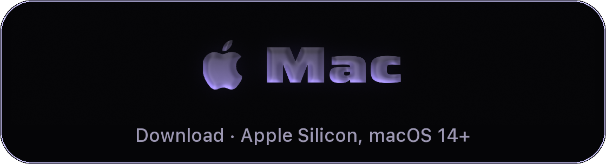
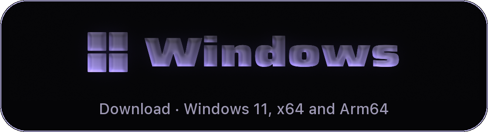
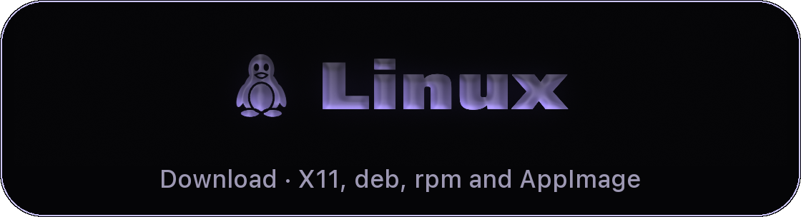

  

<h3 align="center">Your coding agents, in the notch.</h3>

  Openbar lists every Claude Code and Codex session beside your Mac's camera. 
  When one needs you, you allow it, answer it or reply from there.

  
  
  
  

  
  
  

  <a href="docs/README.md">Features and guides</a>
  &nbsp;&nbsp;&nbsp;
  <a href="https://github.com/MF-DEEV/Openbar/discussions">Discussions</a>

https://github.com/user-attachments/assets/e6782d65-7822-4d9a-9ad4-3f31c8c35df4

Laptop model: "2021 Macbook Pro 14" (M1 Pro / M1 Max)" by akshatmittal on Sketchfab, <a href="https://creativecommons.org/licenses/by/4.0/">CC BY 4.0</a>.

## What it does

- Permission requests, questions and plans open in the island with the full command or diff.
- A reply you type or speak lands in the session's own terminal or editor.
- Claude Code, Codex, OpenCode, Gemini CLI, Copilot CLI and Cursor share one list.
- Each session you start from the island gets its own git worktree.
- Nothing leaves your machine ([privacy](docs/PRIVACY.md)).
- A menu bar toolkit comes with it: a volume mixer, a system monitor, clipboard history and more.

## Install

**Mac** (Apple Silicon, macOS 14 or later): get the DMG from the [latest Mac release](https://github.com/MF-DEEV/Openbar/releases?q=Mac&expanded=true) and drag Openbar to Applications. It isn't notarized yet, so the first time choose **Open Anyway** in System Settings › Privacy & Security.

**Windows 11** (beta): run the installer from the [latest Windows release](https://github.com/MF-DEEV/Openbar/releases?q=windows&expanded=true).

**Linux** (X11, beta): get the `.deb`, `.rpm` or AppImage from the [latest Linux release](https://github.com/MF-DEEV/Openbar/releases?q=linux&expanded=true), for x86_64 or Arm64. Wayland isn't supported yet; see the [Linux notes](windows/docs/linux.md).

On the Mac, turn sessions on in Openbar's Settings: install **AI Agents** in the Features hub, turn on **Sessions** under Dynamic Island and press **Install Hooks** for Claude Code. Then start `claude` or `codex`.

## Docs

[Features and guides](docs/README.md) · [Privacy](docs/PRIVACY.md) · [Permissions](docs/PERMISSIONS.md) · [Troubleshooting](docs/TROUBLESHOOTING.md) · [Windows](windows/README.md) · [Contributing](CONTRIBUTING.md) · [Security](SECURITY.md) · [Code of conduct](CODE_OF_CONDUCT.md)

## License

[GPL 3.0 or later](LICENSE). Openbar is built on [Vorssaint](https://github.com/vorssaint/vorssaint-utils), copyright 2026 Vorssaint; the changes in this repository are copyright 2026 MF DEV, Adrian (@atekuu) and the Openbar contributors, under the same license. Openbar is not affiliated with Vorssaint; see [TRADEMARKS.md](TRADEMARKS.md).

## Contributors

  <table>
    <tr>
      <td align="center" width="150"><a href="https://github.com/MF-DEEV"> <b>MF DEV</b></a></td>
      <td align="center" width="150"><a href="https://github.com/atekuu"> <b>Adrian</b></a></td>
      <td align="center" width="150"><a href="https://github.com/Dotims"> <b>Dotims</b></a></td>
    </tr>
  </table>

