# Openbar: features and guides

What Openbar does on each platform, with recordings, and the guides that go deeper. To install it, see the [README](../README.md#install).

<p align="center">
  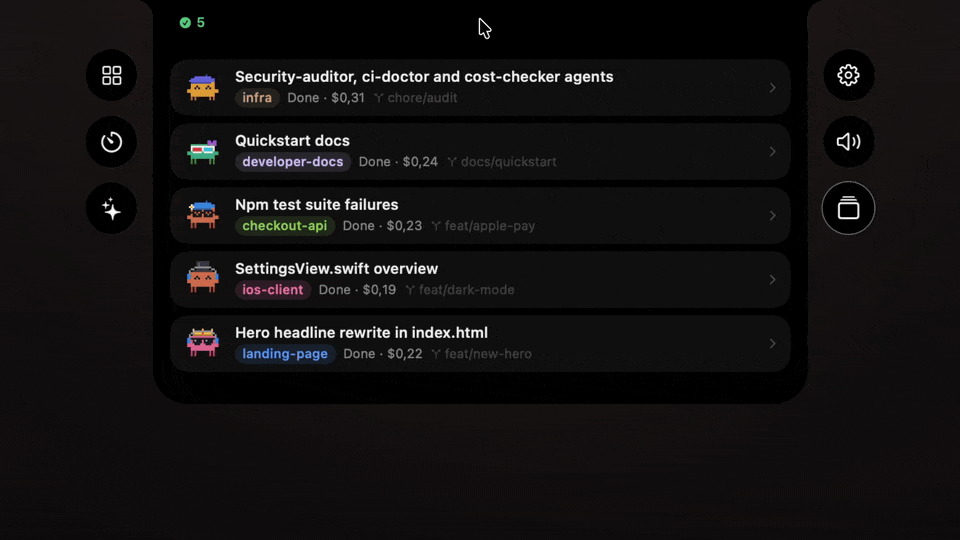
</p>

## Sessions

Every agent session on your machine, beside the camera. When one needs you, the island opens with the request in full.

<table>
  <tr>
    <td width="50%">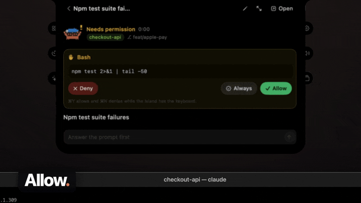</td>
    <td width="50%">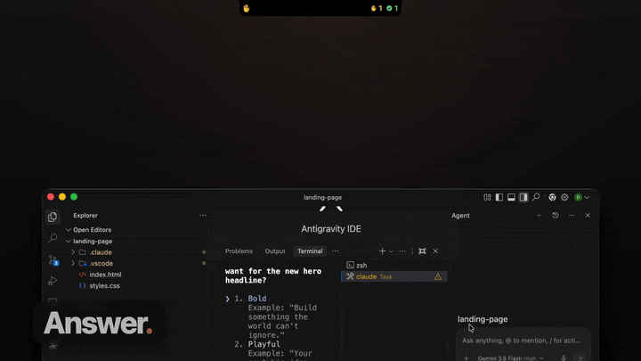</td>
  </tr>
  <tr>
    <td><b>Allow</b><br>Allow, Deny or Always, with the whole command or the file diff in view, and more of the file a click away. <kbd>⌘Y</kbd> <kbd>⌘N</kbd> <kbd>⌘T</kbd> work from any app.</td>
    <td><b>Answer</b><br>Pick one option, several, or write your own.</td>
  </tr>
  <tr>
    <td>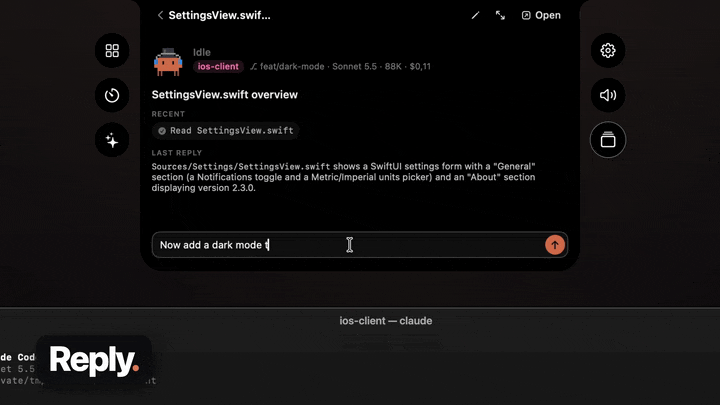</td>
    <td>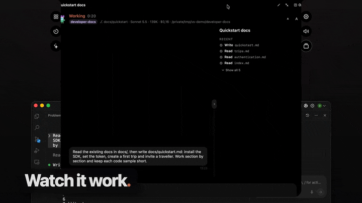</td>
  </tr>
  <tr>
    <td><b>Reply</b><br>Type or speak in the island and it lands in the session's own terminal or editor. Images too. Speech is recognized on your machine.</td>
    <td><b>Watch</b><br>Enlarge a session to read the conversation live, with tools, tasks, cost and model.</td>
  </tr>
  <tr>
    <td>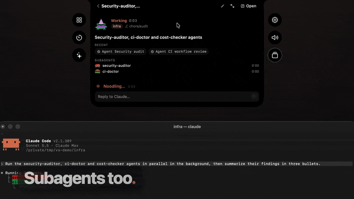</td>
    <td>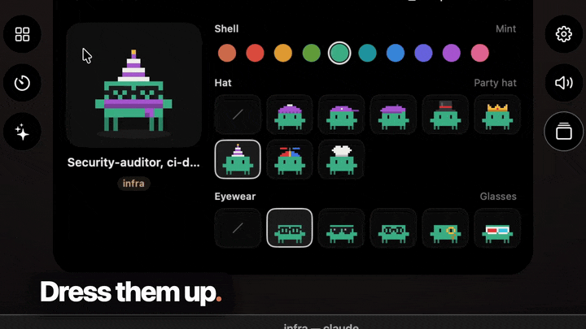</td>
  </tr>
  <tr>
    <td><b>Subagents</b><br>Agents a session starts get rows of their own, background ones included.</td>
    <td><b>A Clawd each</b><br>Every session gets a pixel buddy in a random costume. Dress it up.</td>
  </tr>
</table>

| Agent | In the list | Approve in the island | Reply from the island |
|---|:-:|:-:|:-:|
| Claude Code | ✓ | ✓ | ✓ |
| Codex | ✓ | ✓ | ✓ |
| OpenCode | ✓ | ✓ | ✓ |
| Gemini CLI | ✓ | in Gemini CLI | ✓ |
| Copilot CLI | ✓ | in Copilot CLI | ✓ |
| Cursor | ✓ | in Cursor | `cursor-agent` only |
| Pi | ✓ | asks none | ✓ |
| Mistral Vibe | ✓ | in Mistral Vibe | ✓ |
| Devin CLI | ✓ | in Devin CLI | ✓ |

Background sessions (`claude --bg`), plan limits and **New session** are there too. Each session started from New session gets [its own git worktree](session-worktrees.md), so agents working on one repo don't change each other's files. Sessions on [machines you reach over SSH](remote-hosts.md) can show up too, with the host's name on them. See [what each agent allows](more-session-agents.md) and [which terminals replies reach](terminal-hosts.md).

## The rest of your Mac

Openbar grew out of a full menu bar toolkit, and all of it is still here. Install only the features you use.

<table>
  <tr>
    <td width="50%"></td>
    <td width="50%"></td>
  </tr>
  <tr>
    <td><b>App switcher</b><br>Windows, not just apps, with live previews.</td>
    <td><b>Shelf</b><br>Park files on the way from one app to another.</td>
  </tr>
  <tr>
    <td></td>
    <td></td>
  </tr>
  <tr>
    <td><b>Cut and paste</b><br><kbd>⌘X</kbd> and <kbd>⌘V</kbd> move files in Finder.</td>
    <td><b>Quit on close</b><br>Closing the last window quits the app.</td>
  </tr>
</table>

A volume mixer, a system monitor, clipboard history, window layouts, keep awake, Now Playing, a timer, a calendar, downloads and more are each one switch away in the Features hub.

## On Windows 11

The same island, built with Tauri, hangs from the top of a Windows 11 screen. It's a beta with its own installer for x64 and arm64.

<p align="center">
  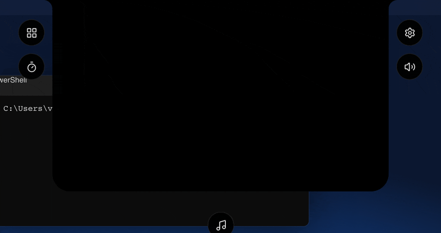
</p>

<table>
  <tr>
    <td width="50%">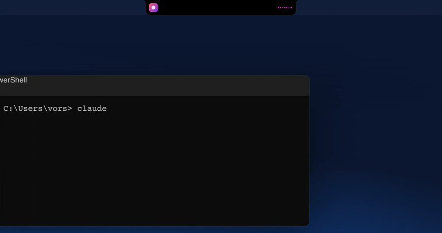</td>
    <td width="50%">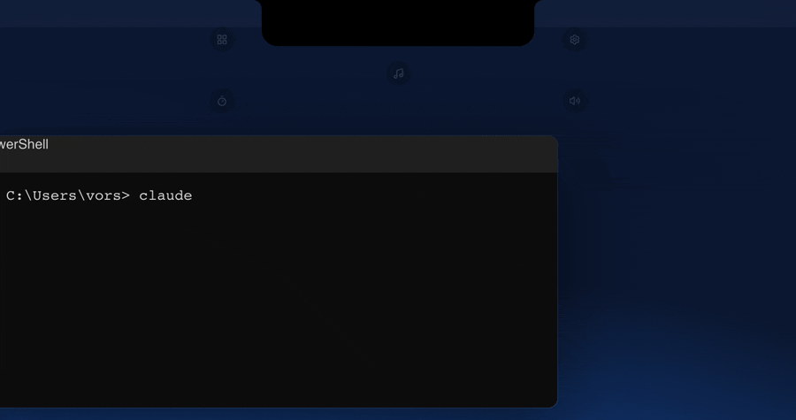</td>
  </tr>
  <tr>
    <td><b>Now Playing</b><br>Spotify, a browser or Media Player, with synced lyrics and what's up next.</td>
    <td><b>Controls and mixer</b><br>Volume, outputs and a level for every app playing sound.</td>
  </tr>
  <tr>
    <td>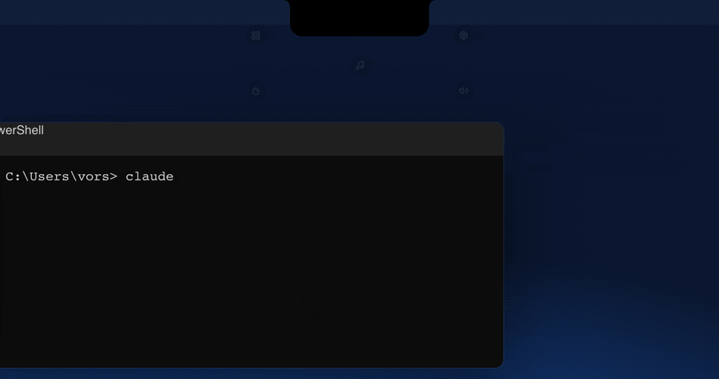</td>
    <td>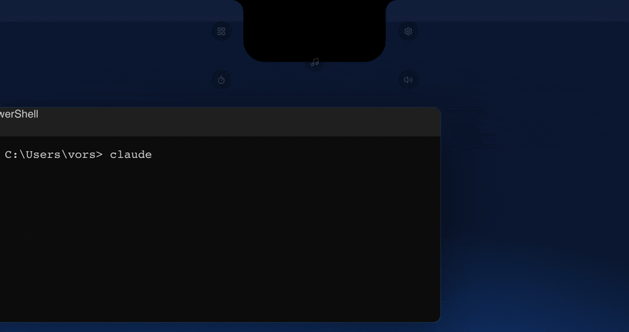</td>
  </tr>
  <tr>
    <td><b>System</b><br>Processor, memory, battery, network and disk, live, with history a click away.</td>
    <td><b>Clipboard and Files</b><br>A searchable clipboard history and a shelf for files on the move.</td>
  </tr>
</table>

<p align="center"><sub>Recorded from the Windows island's own interface with sample data.</sub></p>

[Download the installer](https://github.com/MF-DEEV/Openbar/releases?q=windows&expanded=true) or [read the Windows notes](../windows/README.md) for timers, calendar, downloads, screen capture, Watch and the rest.

## Build the Mac app from source

You need Apple Silicon, macOS 14 or later and the Xcode Command Line Tools.

```sh
git clone https://github.com/MF-DEEV/Openbar.git
cd Openbar
./build.sh --dev --install
```

Then turn on Sessions as the [README](../README.md#install) describes.

> [!NOTE]
> This builds **Openbar (Developer)**. It has its own bundle ID, so it can sit beside an installed Openbar, but run only one of them at a time or you get two islands.

[CONTRIBUTING.md](../CONTRIBUTING.md) covers the tests, the layout and the checks every pull request runs.

## Private by default

> [!IMPORTANT]
> Nothing leaves your machine. Prompts, replies and commands stay hidden until you turn on **Show previews**, and even then they're kept in memory only. With the app closed, your agents ask in the terminal as usual. See [everything the app reads and writes](PRIVACY.md).

## Guides

| Guide | What it covers |
|---|---|
| [Privacy](PRIVACY.md) | What is read, what is kept, what never leaves |
| [Permissions](PERMISSIONS.md) | Every macOS permission, in plain words |
| [Troubleshooting](TROUBLESHOOTING.md) | The common fixes |
| [Claude Code sessions](claude-sessions-spike.md) | What Claude Code exposes and how the island uses it |
| [Codex sessions](codex-sessions.md) | How the island talks to Codex's app server |
| [More agents](more-session-agents.md) | Gemini CLI, Copilot CLI, OpenCode, Cursor, Pi, Mistral Vibe and Devin CLI |
| [Background sessions](background-sessions.md) | `claude --bg`, Agent View and New session |
| [Session worktrees](session-worktrees.md) | A git worktree for each session started from New session |
| [Terminals](terminal-hosts.md) | Every terminal and editor replies reach |
| [Remote hosts](remote-hosts.md) | Sessions on machines reached over SSH |
| [Windows](../windows/README.md) | The Windows island, installer and build |
| [Linux](../windows/docs/linux.md) | The island under X11: the build and what works |
