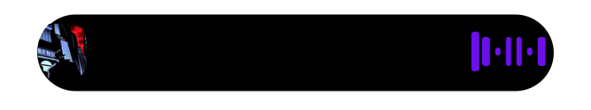
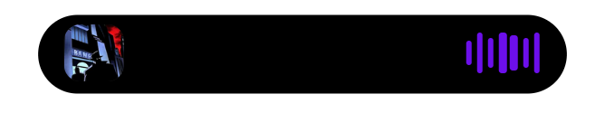

# Music capsule artwork spacing

Actual captures and DOM/SVG measurements from the locally installed Windows Tauri application while music was playing. No mock playback or injected styles were used.

| Measurement | Before | After |
| --- | ---: | ---: |
| Artwork distance from the painted left edge | -2.17 px | 7.99 px |
| Equalizer distance from the painted right edge | 2.83 px | 7.99 px |

The negative distance means the artwork extended beyond the visible capsule boundary. Both ends now have the intended 8 px inset; the top and bottom artwork gaps remain 3 px.

Before: 

After: 

Raw measurements: [before](before.json), [after](after.json).

The verified local build also retained the existing permission security changes from PR #226. Those changes are excluded from this artwork-spacing PR.
