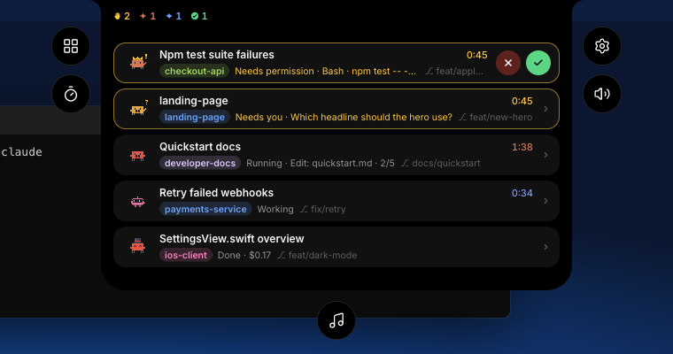

<h1 align="center">Vorssaint for Windows</h1>

<p align="center">
  The Dynamic Island from Vorssaint for Mac, at the top of a Windows 11 screen.<br>
  Your music, your notifications and every Claude Code and Codex session, one click away.
</p>

<p align="center">
  <a href="https://github.com/MF-DEEV/vorssaint-utils/releases?q=windows&expanded=true"><b>Download</b></a> ·
  <a href="#install">Install</a> ·
  <a href="#what-it-does">What it does</a> ·
  <a href="#private-by-default">Privacy</a> ·
  <a href="#build-it-yourself">Build it yourself</a>
</p>

<p align="center">
  
</p>

<p align="center"><sub>The Sessions page, shown with demo sessions.</sub></p>

This is a port of the Dynamic Island from the unofficial [Vorssaint](https://github.com/vorssaint/vorssaint-utils) fork in this repository. It is not affiliated with or endorsed by the Vorssaint maintainer. It is a beta: the sections listed under [Not yet](#not-yet) show a placeholder for now.

## Install

1. Download the installer for your PC from the [latest Windows release](https://github.com/MF-DEEV/vorssaint-utils/releases?q=windows&expanded=true):
   - `Vorssaint_<version>_x64-setup.exe` for most PCs (Intel and AMD).
   - `Vorssaint_<version>_arm64-setup.exe` for PCs with a Snapdragon or other ARM processor.
2. Run it. The installer isn't signed yet, so Windows may say **Windows protected your PC**. Choose **More info**, then **Run anyway**.
3. Go through the setup. It installs for your account only, needs no administrator password, and starts the island when it's done.

You need Windows 11. The island sits at the top center of your main display. Click it to open, or press **Ctrl+Alt+Space** from any app.

To remove it, use **Settings › Apps › Installed apps › Vorssaint › Uninstall**. That also takes out its Start with Windows entry and the hooks it added to Claude Code.

## What it does

- **A notch at the top of the screen.** A black island hangs from the top edge, like the camera housing on a MacBook, or floats as a capsule if you prefer. It grows into pages when you click it and steps aside for games and films in full screen.
- **Now Playing.** Whatever plays in Spotify, a browser or Media Player shows beside the camera with its cover and moving bars. Open it to see the song, scrub, shuffle and control playback. Media keys keep working as usual.
- **Choose a live activity.** When music and sessions are active together, clicking the compact island shows **Sessions / Music**. Pick what its strip shows, then click the strip to open that page. Hover only enlarges the strip by 3%. The selection closes when the pointer leaves or you press Escape.
- **A layout that fits.** The island's content scales proportionally with custom width and height. Covers, text, controls and spacing keep their proportions; long track titles scroll within their row.
- **Controls.** The home page: volume with a quick switch between outputs, the brightness of your displays (turn it on in **Content › Controls**), what's playing, and tiles for Keep awake, the timer, the next calendar event, the mixer and more. Choose and order the tiles in **Content › Controls**.
- **Volume mixer.** The master volume, the microphone and a column for every app playing sound, each with its own level and mute. Pin apps, reorder them with Ctrl+drag, hide the ones you don't need, and switch the output or input device from the top row. Under Options: lower the speakers when headphones disconnect, finer 1% volume-key steps, a shortcut that cycles your chosen outputs (Ctrl+Alt+Shift+S by default), and audio priority lists that pick the best connected output and microphone.
- **Timer.** A countdown, Pomodoro or stopwatch. Pick the minutes on a ruler; the time left shows beside the camera, and a chime repeats when it's up, for up to five minutes or until you dismiss it.
- **Microphone Status.** Muting in Discord shows a red microphone; deafening shows both red headphones and a red microphone, with a short animated notice when muted or unmuted. The unmute notice disappears after three seconds; an active, unmuted microphone has no persistent indicator. Toggle this in **Activity › Microphone Status**. Visible Discord controls in Polish or English provide live mute/deafen state. While Discord is minimized or hidden in the tray, the island follows the mute/deafen shortcuts configured in Discord, including supported keyboard and mouse combinations. It observes those combinations without registering or intercepting them. Returning to Discord synchronizes the state with its controls. The app reads the local keybind configuration without changing it. Browser Discord is not monitored. No audio is recorded and no Discord login or token is needed.
- **Download progress.** New file transfers show a small live indicator. Click it to open a Downloads page with file icons, names and transferred MB; download details never pop up automatically. The app watches the Windows Downloads folder, configured Brave, Chrome, Edge, Vivaldi, Opera and Firefox download folders, plus folders added in **Content › Downloads**. Other programs writing to those folders are supported too. Chromium browsers provide total sizes when available; other transfers show received bytes and an indeterminate indicator. File copies in these folders also appear. Subfolders, protected application caches and downloads outside monitored folders are not scanned. Turn monitoring off in **Activity › Download progress**. Only local metadata and the browser's download records are read; file contents and browsing URLs are not collected.
- **System.** CPU, GPU, memory, battery, network, free disk space, battery power draw and connected USB and Bluetooth devices, as cards that turn orange when something needs attention. Click a card for its recent history; CPU and memory also list the apps using the most, the battery shows its health and cycle count, and the network has a speed test. Readings are taken only while the page is open; a speed test you start runs to the end. Set how often it updates, the network unit and which cards show in **Content › System**.
- **Clipboard.** What you copy, kept in a history you can search, pin and paste from (Enter, a click or Ctrl+1…9). It's off until you turn it on; then it skips content password managers mark as private, text that looks like a password if you choose, and apps you list.
- **Files.** Drop files, pictures, text or links on the island to keep them at hand. Drag them out again into any app, open them, share them, show them in File Explorer, or pack the selection into ZIP files.
- **Tools.** Keep awake, mute the microphone, take a screenshot, copy text from any part of the screen, pick a colour, and quick toggles for dark mode, the Recycle Bin, ejecting disks, hidden files, desktop icons, locking the PC, turning the display off and starting the screen saver.
- **Scratchpad.** Notes in tabs that save as you type, with lists, checkboxes and a preview.
- **AI Agents.** Plan limits, tokens and the API value of your Claude Code, Codex, OpenCode and GitHub Copilot use, read from their local logs, with a live indicator while an agent works.
- **Notifications (requires package identity).** Discord, Messenger and other Windows notifications show the app icon, app name and sender, without message text. Discord's Do Not Disturb and muted chats follow its desktop notifications. See [package identity and setup](docs/notifications.md).
- **Calendar (requires package identity).** The week as a strip, or the month beside your agenda on a tall island, with every appointment from the Windows Calendar app and classic Outlook. In the hour before a meeting the closed island counts down to it (**Content › Calendar › Event countdown**, or right-click one appointment and choose **Add Countdown**). Windows asks once for calendar access. The new Outlook keeps its calendar to itself, so its appointments don't show.
- **Watch.** Drag over any part of a window, like a progress bar, a build status or a score, and the closed island shows what it reads beside a breathing eye. It tells you when the area changes, stops changing, shows the text you typed or reaches a number. The window is followed even when covered or on another desktop, and Windows draws its yellow capture border around it unless it allows borderless capture. The area is read on your PC with Windows' own text recognition; nothing is saved or sent.
- **Claude Code and Codex sessions.** Every session running on your PC, in one list. Each shows its folder, branch and what it's doing: working, running a tool, waiting for you, or done.
  - **Allow from the island.** On the desktop, a session that needs approval opens with the whole command in view. While another app or a game is in front, it stays in the small waiting-hand indicator without taking focus. Returning to the desktop checks all still-pending requests, including ones that were waiting before the app started. Allow, Deny or Always.
  - **Answer questions.** Pick one of the answers a session offers, or write your own.
  - **Reply without switching apps.** Type in the island and it reaches the session.
  - **Open.** Brings the session's terminal window forward.
  - **A buddy for every session.** Clawd for Claude Code and a little terminal robot for Codex, each in a random outfit you can change.
- **Settings like Windows.** Size, shape, which sections show and in what order, how it opens, which display it uses, starting with Windows and more, in a window that follows your light or dark theme. In **Content**, use **+** beneath the preview to add shortcut circles, choose their actions, move them left, right or below the island, reorder or remove them. Each position fits three circles. **Restore defaults** returns the original five shortcuts. Preview circles and settings rows share animated, keyboard-accessible menus.

### Using it with Claude Code

Open the island's settings with the gear beside it, go to **Content › Sessions** and choose **Install hooks**. Vorssaint adds its hooks to `~/.claude/settings.json`, next to your own and with a backup first. Without them the island still lists your sessions, but it can't answer their permission prompts.

### Using it with Codex

Nothing to install. While Codex runs, the island talks to the app server Codex starts for its terminal sessions, so approvals and replies go to Codex itself.

## Private by default

- Nothing the island reads leaves your PC. There is no telemetry, no analytics and no account.
- Prompts, replies, session titles and command output stay hidden unless you turn on **Show previews** in **Content › Sessions**. With it on, they are kept in memory only and cleared when you turn it off.
- A permission prompt always shows what it would run, so nothing is allowed unread.
- Your settings live in `%APPDATA%\com.vorssaint.island\settings.json` and only hold what you changed.
- The clipboard history, the Files shelf, the scratchpad and the audio priority lists are saved in the same folder, so they survive a restart. Uninstalling keeps them unless you tick the box to delete app data.
- AI Agents reads Claude Code, Codex, OpenCode and Copilot logs on this PC and asks the `claude` and `codex` programs for your plan limits; it never reads their sign-in files. Once a day it downloads the public price list from GitHub, which you can turn off in **Content › AI Agents**.
- The speed test in the network detail reaches Cloudflare's public speed endpoints (`speed.cloudflare.com`) only when you start it. It uploads zeros, never your data.

## Not yet

- Recent captures and the camera mirror show "Coming to Windows soon".
- The mixer stops at 100% (Windows can't boost one app) and doesn't send apps to separate outputs. Keyboard backlight, screen recording and the Mac's media tools have no Windows version.
- Notifications and Calendar need the signed identity package. Only installers built with it (see below) carry it; without it their pages say so.
- There are no automatic updates. To update, run the newer installer over the old one; your settings stay.
- The settings window is in English.
- Codex sessions are tested end to end on Windows. Claude Code sessions use the same island, but their hooks and replies typed into Windows Terminal haven't been tested end to end on Windows yet.

## Build it yourself

You need [Bun](https://bun.sh), [Rust](https://rustup.rs) and, on Windows, the [Tauri prerequisites](https://v2.tauri.app/start/prerequisites/).

```sh
cd windows
bun install
bun run tauri build
```

The installer lands in `src-tauri/target/release/bundle/nsis/`. The installers in the releases are cross-compiled on a Mac with `cargo-xwin` and `makensis`:

```sh
bunx tauri build --runner cargo-xwin --target x86_64-pc-windows-msvc
bunx tauri build --runner cargo-xwin --target aarch64-pc-windows-msvc
```

### The identity package

Notifications and Calendar need a package identity, which a signed sparse package lends `Vorssaint.exe`. Build it once per release on Windows with the Windows SDK; the signing key stays outside the repository:

```powershell
$env:VORSSAINT_SIGNING_PFX = 'C:\keys\vorssaint-signing.pfx'
$env:VORSSAINT_SIGNING_PASSWORD = '…'
.\tools\package-identity\build-sparse.ps1 -NewCertificate   # the first time only; later runs reuse the PFX
```

From the Mac, `tools/package-identity/build-sparse-vm.sh` runs the same script in the build VM and copies the result back. Either way `packaging/out` gets `Vorssaint.msix` and `Vorssaint.cer`, and an installer built with

```sh
bunx tauri build --runner cargo-xwin --target x86_64-pc-windows-msvc --config src-tauri/tauri.identity.conf.json
```

carries them. See [docs/notifications.md](docs/notifications.md) for what the installer does with them.

For a local update of an existing Windows installation, build with `bun run tauri build --no-bundle`, then run:

```powershell
.\tools\install-local.ps1 -ExecutablePath .\src-tauri\target\release\Vorssaint.exe -EnableAutostart
```

This keeps a backup of the installed executable and preserves settings. It rejects console executables, so a local build cannot accidentally make the island depend on a terminal window. The island uses the Windows GUI subsystem in both release and debug builds; use a full Tauri build for installation so the frontend is bundled and no development server is needed.

Tests run with `bun run test` and, in `src-tauri` after `bun run build`, `cargo test`; the [checks on pull requests](../README.md#checks-on-pull-requests) list everything CI runs. The design notes behind the port are in [`docs/spec`](docs/spec).

On Windows with Microsoft Edge installed, browser regressions are available as `npm run test:island-layout`, `npm run test:settings-select`, `npm run test:quick-access` and `npm run test:activity-picker`. They launch an isolated headless browser with sample sessions and media, and save screenshots under the repository's ignored `build/` directory. Set `ISLAND_TEST_BROWSER` to use another Chromium executable. The activity-picker check also samples animation frames to catch duplicated strips or a vertical jump while closing.

## License

GPL-3.0-or-later, like Vorssaint. See [LICENSE](../LICENSE).
